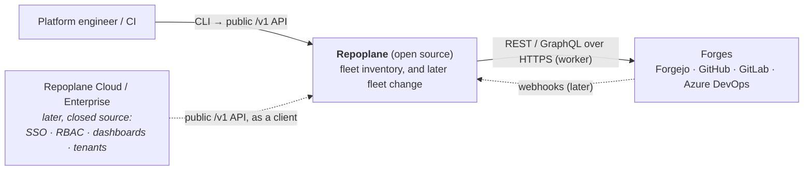
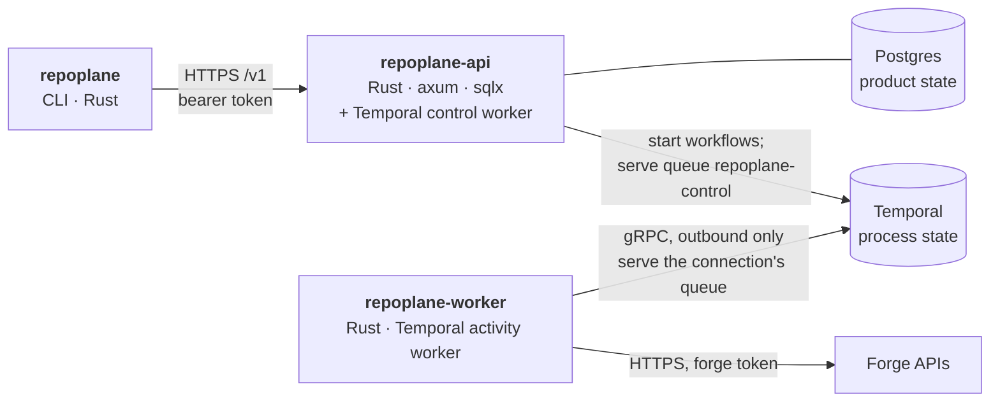

# Architecture

Repoplane keeps an accurate inventory of a repository fleet across **Forgejo, GitHub, GitLab
and Azure DevOps**. Later it will change the fleet and prove the changes converged. This page
has the C4 views (context, containers, components) and the rules that keep them honest. The
decisions behind the rules are in [`adr/`](adr).

Two things shape everything below:

1. **Open source, installable on premises.** The CLI, API and worker are open source and run
   wherever the customer chooses, so a bank can audit every line that touches its code and its
   credentials. A later, separate *Repoplane Cloud / Enterprise* plane consumes the same public
   API and adds SSO, RBAC, dashboards and tenants on top, without a fork. This is the split
   Temporal and Temporal Cloud have.
2. **Four forges from day 0.** They differ too much in pagination, rate limits, topics and
   namespaces to bolt three of them onto a GitHub-shaped core later.

## Level 1: system context



**The rule:** everything that reads source code or holds a forge credential is open source and
runs where the customer chooses. The enterprise plane never talks to a forge. It talks only to
the repoplane API.

## Level 2: containers



| Container | Owns | Talks to | Never |
|---|---|---|---|
| `repoplane` (CLI) | nothing | the API's `/v1` | touches the database, Temporal or a forge; links none of them |
| `repoplane-api` | Postgres: connections, inventory, runs; migrations. Runs the workflows and the Postgres activities | Postgres; Temporal; serves `/v1` | calls a forge; holds a forge credential |
| `repoplane-worker` | the forge tokens, each keyed by the host and organisation it may be sent to ([ADR 0014](adr/0014-the-worker-chooses-each-connections-token.md)) | Temporal, outbound; forges | opens a database; calls the repoplane API; accepts a connection |
| Temporal | process state: what step each run is at, timers, retries, signals | — | holds a secret (a connection carries no credential) |

**Temporal orchestrates; Postgres is product state** ([ADR 0012](adr/0012-temporal-orchestrates.md)).
A run is a Temporal workflow whose id is the run's id (`rec_…`, `hrf_…`). Each of its steps is an
activity on an explicit task queue:

- Postgres steps go to `repoplane-control`, served by the API process.
- Forge steps go to the connection's own queue (`default` unless set), served by workers.

One code base therefore gives three deployments:

```text
Single node          docker compose: api + postgres + temporal + worker
Full on-premises     api + postgres + Temporal + workers, all inside the customer's network
Hybrid (Cloud)       api and Temporal hosted (Repoplane Cloud / Temporal Cloud); the customer runs only
                     workers on its own queue, so tokens and source code never leave its network
```

Temporal gives each run durable retries with backoff. A run survives any of its processes
dying, and timers measured in days are just a step that waits; signals reach a run in flight.
Campaigns will need all of this: waiting for merges, waves, pausing.

## Level 3: components

### repoplane-api

| Component | Responsibility |
|---|---|
| `http` (`/v1`) | connections, added only once a worker on their queue has listed the organisation (a `check-connection` workflow; `--no-check` skips it), reconciles, head refreshes and syncs (each with `?wait=` long-poll on Postgres), repositories (filtered, keyset-paged). One bearer token, `REPOPLANE_TOKEN` by default. Asking for a run records it, then starts its workflow; if Temporal will not take it, the run is recorded failed and the call answers 503. Serving a run still in flight, it asks Temporal about its workflow and records the run as failed if the workflow closed without recording it, is gone, or has a workflow task that keeps failing, its own or that of a child it waits on (ADR 0013). |
| `control` | the Postgres activities: one store call each, safe to repeat; a refusal from the store is non-retryable |
| control worker | Temporal worker on `repoplane-control`, hosting the workflows and the control activities; it shares the process and the shutdown with the HTTP server |
| `store` | run steps (`start_*`, `record_*`, `unseen`, `finish_*`, `fail_*`), the inventory upsert (identity by forge id, watermark, never delete), migrations |

### repoplane-flow (the workflows)

| Workflow | Steps |
|---|---|
| `ReconcileWorkflow` (`connection reconcile`) | `start_reconcile` → `list_page` for the first page → `record_page`. If that page said how many pages there are, every other page is scheduled at once; otherwise they are walked one by one. Pages are recorded one after another either way. Then `unseen` → `LookupsWorkflow` children of at most 1,000 ids, all at once, each looking up every id at once and recording the ones still there → `finish_reconcile`, which marks the rest inaccessible. Marking happens only after the whole listing and the lookups succeeded (ADR 0005). |
| `RefreshHeadsWorkflow` (`repo refresh-heads`) | `start_refresh` (targets fixed at request) → `ReadHeadsWorkflow` children of at most 1,000 targets, all at once, each with one `read_head` per target at once, then `record_heads` (target-scoped, branch-guarded, each target counted once) → `finish_refresh` |
| `SyncWorkflow` (`connection sync`) | `start_sync` → `ReconcileWorkflow` as a child, under the reconcile's run id → `sync_heads` (requests a refresh of every active repository, once) → `RefreshHeadsWorkflow` as a child, under the refresh's run id → `finish_sync`. A failing step fails the sync with the step's reason (ADR 0013). |

Workflows size no batches for speed. They schedule every page, lookup and HEAD read at once,
and the worker's activity slots (`concurrency`, 64 by default) are the only bound on how many
run at a time: Temporal hands a worker as many tasks as it has free slots. Each forge step is
retried on its own, so one repository the forge could not answer for is retried alone.

Temporal refuses more than 2,000 pending activities per workflow, so lookups and HEAD reads go
to child workflows of at most 1,000 each (ADR 0013). This was measured: 2,139 HEAD reads
scheduled in one workflow stalled it. A child's history is about 4,000 events per 1,000
repositories, well under Temporal's 51,200.

Forge steps retry 8 times, backing off from 1s to 60s. A forge that says it is rate limiting
(a 429 over its API or over git) is retried after the wait it asked for, or a minute when it
does not say, for up to 30 attempts: retrying within seconds lands in the same window and only
spends the quota again. The rule is the same on every forge; only a forge that rate limits
waits. A failure the worker marks non-retryable (a refused token, a forge the worker holds no
token for, a protocol violation) fails the run at once. The run's record then says why, from
the forge's own message.

Forge steps heartbeat every few seconds, rate-limit waits included. A step whose worker dies is
given up 30 s after its last heartbeat and run again on another worker, rather than after its
15-minute timeout; a step whose run ended is cancelled, and stops its forge call. A worker that
is stopped finishes what it can for 30 s, then cancels the rest, which Temporal runs elsewhere.
If the Temporal worker inside `repoplane-api` or `repoplane-worker` stops by itself (a namespace
that fails validation, a key that no longer works), the process exits with an error, so it is
restarted rather than left up with nothing polling.

Every activity's input and output lives in workflow history, so none carries a secret: a
connection travels as its *variable name*. A replay test replays recorded histories against the
current code, so a change that would strand runs in flight fails `make unit`.

### repoplane-worker

Three forge activities, thin wrappers over `repoplane-forge`:
- `list_page`: one page of the organisation.
- `lookup`: one repository by id, if it still exists in the organisation.
- `read_head`: one repository's default-branch HEAD, naming its branch, read with `git ls-remote`
  (below).

A forge error becomes a retryable activity failure when the forge was busy or unreachable, and a
non-retryable one otherwise. `concurrency` bounds the activities run at once.

### repoplane-forge (the adapters)

```rust
trait Lister {
    fn kind(&self) -> ForgeKind;                                       // and so its Caps
    async fn page(&self, cursor: Option<&str>) -> Result<Page, ForgeError>;
    async fn heads(&self, repos: &[Listed]) -> Result<Vec<Option<String>>, ForgeError>;
    async fn get(&self, external_id: &str) -> Result<Option<Listed>, ForgeError>;  // by forge id
}
```

Every method is mandatory, so a forge that cannot do something says so explicitly. One
`HttpClient` under all four adapters owns the retry budget (10 minutes per logical request),
backoff with jitter, and waiting out a rate limit. Each adapter supplies its own **classifier**,
because each forge signals a limit differently. The client also scrubs the token from every
error, and follows a redirect only within the forge's origin: one to another host is reported,
not followed, so the token is never sent there. The ideas come from forgelab, but the code is
written independently: forgelab's own design requires the harness to be *independently wrong*
from the system it tests.

| | Listing | Topics | Archived | git remote for HEADs |
|---|---|---|---|---|
| **Forgejo** | `GET /orgs/{org}/repos`, 50 per page (the server clamps); only the page *number* is taken from `Link`, because Forgejo writes it from its own `ROOT_URL` | in the payload | `archived` | `{base}/{owner}/{repo}.git` |
| **GitHub** | `GET /orgs/{org}/repos`, 100 per page, `Link` rel=next only | in the payload | `archived` | `https://github.com/{owner}/{repo}.git` (or the Enterprise host), user `x-access-token` |
| **GitLab** | `GET /groups/{path}/projects?include_subgroups=true`, 100 per page; offset, because keyset is silently ignored on this endpoint | in the payload | `archived`; projects pending deletion excluded | `{base}/{group}/…/{project}.git`, user `oauth2` |
| **Azure DevOps** | `GET {org}/_apis/git/repositories`: every project, disabled repositories included, in one answer | **none**: `topics` is `null`, and `--topic` on such a connection is refused | `isDisabled`, whose HEAD cannot be read (never asked) | `{base}/{org}/{project}/_git/{repo}` |

Reconcile and head refresh are separate operations
([ADR 0011](adr/0011-inventory-and-heads-are-separate.md)). A reconcile records what exists and
never reads a HEAD. When it sees a repository's default branch change, it clears the recorded
HEAD, because that HEAD described another branch. A head refresh reads the HEADs of the
repositories it was given, and stamps each with `head_observed_at`. The HEAD column above is
therefore the cost of a refresh, paid only for its targets. An empty repository records
`head: null` (`—` in the CLI); that is a fact about the repository, not a failed read. A
repository the forge will not let the token read (a 403 on it alone, as GitLab answers a Guest
of a private project) is *unread*: its last known HEAD stays, and the refresh goes on, counting
it and naming it with the forge's reason. A refresh the forge gives no HEAD at all, refusing it
some, fails: a token every repository refuses is the token's problem. A 401 refuses the token
itself, and fails the run at once.

**HEADs are read over git, not over the API.** One `git ls-remote <remote> refs/heads/<branch>`
per repository, one activity each, as many at once as the worker has slots. Git traffic is not counted against the REST and GraphQL
budgets, which is what made API-read HEADs expensive:
- GitHub limits GraphQL to 60 s of CPU time per minute, which caps HEADs read that way near 600 a
  minute, whatever the concurrency.
- gitlab.com's Free plan allows 100 API requests a minute, and 100 git requests a minute
  (git over HTTPS, LFS and its dependency proxy together): a large group's HEADs are read
  through a few rate-limited retries, at that pace.
- Azure DevOps meters load per user.

How the remote is built:
- From the connection's configured base, never from a URL the forge sent, so the token only
  ever goes to the host the connection names.
- The token travels as an `Authorization` header scoped to that origin through `GIT_CONFIG_*`,
  never in the URL or on the command line.
- git runs with a clean environment: no global or system config, no prompts; only proxy and CA
  variables pass through.
- Empty and disabled repositories cost no call.

Measured on the reseeded sandboxes (median of three syncs, 2026-10-06), reading the HEADs takes
20.9 s for 2,139 repositories on GitHub, 8.7 s for 599 on GitLab and 18.6 s for 2,144 on Azure
DevOps, with the default 64 slots. At 32 slots GitHub and GitLab take twice as long; Azure DevOps
answers no faster above 32. The worker needs `git` on its `PATH`.

**Listing pages are all scheduled at once when the forge says how many there are.** The first page's
`Link rel="last"` names the last page: GitHub, Forgejo and GitLab send it (gitlab.com stops
counting above 10,000 projects). The other pages' URLs must stay under the configured API, or
the listing is walked instead. Azure DevOps answers the whole organisation in one call. On the
two-page sandboxes this changes nothing measurable; it is for organisations of thousands of
repositories, where a page-by-page walk takes a round trip per page.

## Crates and the boundaries between them

```text
crates/
  repoplane-proto    identifiers, API bodies, what crosses an activity. Linked by everything.
  repoplane-flow     workflows and activity definitions. Linked by the API and the worker.
  repoplane-forge    the four adapters and the HTTP layer. Linked by the worker only.
  repoplane-store    Postgres store and migrations. Linked by the API only.
  repoplane-api      bin repoplane-api
  repoplane-worker   bin repoplane-worker
  repoplane-cli      bin repoplane
tests/e2e            the end-to-end suite (test-only; links forgelab)
```

The activity definitions in `repoplane-flow` are implemented on the other side with
`#[activity(definition = …)]`. A mismatch between what a workflow calls and what a worker
implements is therefore a compile error.

`make boundaries` checks the rules against the dependency graph (`cargo tree`) on every lint:
- the CLI links no Temporal, no `sqlx` and no forge client;
- the worker links no `sqlx`;
- the API links no forge client and no HTTP client;
- the workflows link no `sqlx` and no forge client.

So "the component with the database cannot reach a forge" is a property of the build, not just a
claim.

## Identifiers

A UUIDv7 written as a type prefix and 26 characters of Crockford base32, such as
`rec_06G9N084KXVH9BQD3DW01R4TA4`. It says what it names, sorts by creation, and cannot be
misread (no `I`, `L`, `O` or `U`). The prefixes are `org_`, `con_`, `rep_`, `rec_` and `hrf_`. A
run's id is also its Temporal workflow id.

## Secrets

Secrets are named, never written:
- The API's config names the variables that hold its database URL, its token and, for
  Temporal Cloud, the Temporal API key.
- A worker's config names the variables holding its forge tokens, each keyed by where it may
  be sent: `host`, `host:port`, `host/org` or `host:port/org`. A connection carries no
  credential, not even a name: the worker chooses the token by the connection's host and
  organisation, so a token never enters workflow history and never goes to a host its key does
  not name ([ADR 0014](adr/0014-the-worker-chooses-each-connections-token.md)).
- The CLI's contexts file names the variable that holds the API token.

No flag takes a secret, and a value that looks like one is refused where a variable name is
expected.

The connection to Temporal uses TLS when its address is `https://`, verified against the system's
trusted roots (`SSL_CERT_FILE` or `SSL_CERT_DIR` replace them, for a private CA). A Temporal API key
is refused over `http://` unless the address is loopback, such as a TLS-terminating sidecar's.

## Testing

- **Unit (`make unit`):** the four adapters against scripted HTTP; the worker's activities; the
  workflow replay test against recorded histories (`REPOPLANE_RECORD_HISTORIES=1 make e2e`
  re-records them).
- **Store (`make db`):** the run steps against a real Postgres, covering what Temporal's timing
  decides — a step repeated after its commit, a reconcile landing in the middle of a refresh.
- **End-to-end (`make e2e SANDBOX=…`):** the real API, worker and CLI, with Postgres and a
  Temporal dev server in containers, on the **fleets** sandboxes: a local Forgejo, and the
  `repoplane-sandbox` organisations on GitHub, GitLab and Azure DevOps.
  - What each sandbox should hold comes from the fleets' `fleet.lock.json`, never from test code.
  - Mutating scenarios change the real forge, assert the next run records exactly that, then
    forgelab resets and verifies the sandbox.
  - On local, three scenarios use a fault proxy in front of Forgejo: a listing that shifts under
    a deletion, a rate limit longer than one call's budget (waited out as long as the forge
    asked, never retried early), and a refused token (fails fast).
  - A fourth local scenario kills the worker in the middle of a forge call; the run waits,
    and completes once a worker returns, the call being given up on its heartbeat.
  - A fifth adds a connection to a host the worker holds no token for: the run fails at once,
    naming the host.

## Known gaps

- Azure DevOps answers the whole organisation in one listing call, so its single `list_page`
  result carries every repository: 888 KB for 2,144 of them. Temporal warns above 512 KB
  (TMPRL1103) and refuses a payload above 2 MB, so from about 4,800 repositories a reconcile
  would fail. The adapter needs to hand the listing back in pieces.

- A reconcile's history carries every page it recorded: about 1.8 MB for 2,139 repositories,
  against Temporal's 50 MB per workflow. Organisations past a few tens of thousands of
  repositories will need the listing in child workflows or continue-as-new.
- Workers serving the same namespace can poll each other's queues; Temporal Cloud namespaces
  (one per tenant) are the boundary. Per-queue authorisation would need Temporal's own.
