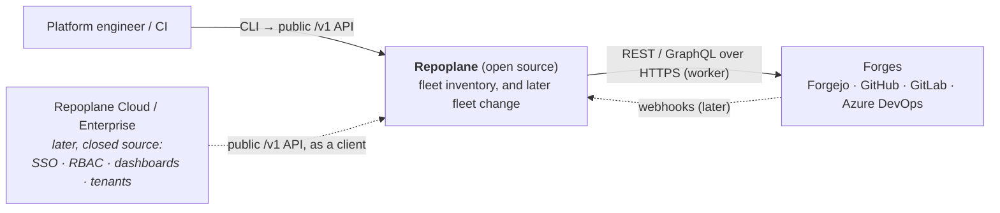
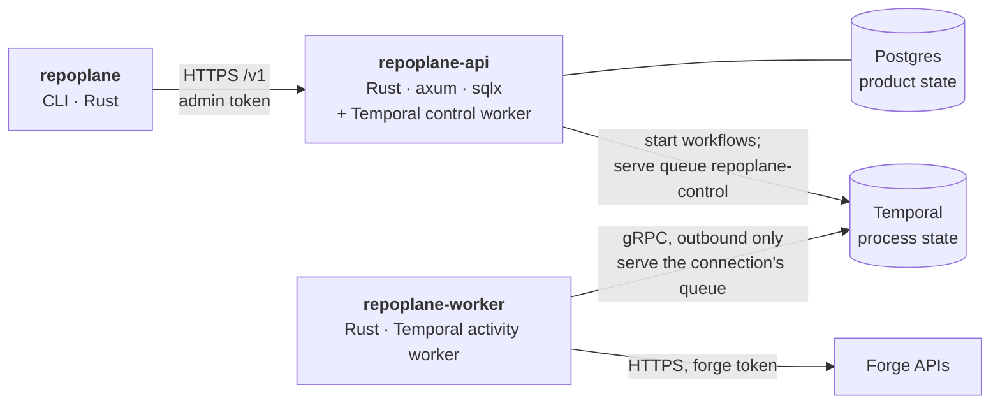

# Architecture

Repoplane keeps an accurate inventory of a repository fleet across **Forgejo, GitHub, GitLab
and Azure DevOps**. Later it will change the fleet and prove the changes converged. This page
has the C4 views (context, containers, components) and the rules that keep them honest. The
decisions behind the rules are in [`adr/`](adr).

Two things shape everything below:

1. **Open source, installable on premises.** The CLI, API and worker are open source and run
   wherever the customer chooses, so a bank can audit every line that touches its code and its
   credentials. A later, separate *Repoplane Cloud / Enterprise* plane consumes the same public
   API and adds SSO, RBAC, dashboards and tenants on top, without a fork. This is the split
   Temporal and Temporal Cloud have.
2. **Four forges from day 0.** They differ too much in pagination, rate limits, topics and
   namespaces to bolt three of them onto a GitHub-shaped core later.

## Level 1: system context



**The rule:** everything that reads source code or holds a forge credential is open source and
runs where the customer chooses. The enterprise plane never talks to a forge. It talks only to
the repoplane API.

## Level 2: containers



| Container | Owns | Talks to | Never |
|---|---|---|---|
| `repoplane` (CLI) | nothing | the API's `/v1` | touches the database, Temporal or a forge; links none of them |
| `repoplane-api` | Postgres: connections, inventory, runs; migrations. Runs the workflows and the Postgres activities | Postgres; Temporal; serves `/v1` | calls a forge; holds a forge credential |
| `repoplane-worker` | the forge tokens (read from the variables each connection names) | Temporal, outbound; forges | opens a database; calls the repoplane API; accepts a connection |
| Temporal | process state: what step each run is at, timers, retries, signals | — | holds a secret (inputs carry variable *names*) |

**Temporal orchestrates; Postgres is product state** ([ADR 0012](adr/0012-temporal-orchestrates.md)).
A run is a Temporal workflow whose id is the run's id (`rec_…`, `hrf_…`). Each of its steps is an
activity on an explicit task queue:

- Postgres steps go to `repoplane-control`, served by the API process.
- Forge steps go to the connection's own queue (`default` unless set), served by workers.

One code base therefore gives three deployments:

```text
Single node          docker compose: api + postgres + temporal + worker
Full on-premises     api + postgres + Temporal + workers, all inside the customer's network
Hybrid (Cloud)       api and Temporal hosted (Repoplane Cloud / Temporal Cloud); the customer runs only
                     workers on its own queue, so tokens and source code never leave its network
```

Temporal gives each run durable retries with backoff. A run survives any of its processes
dying, and timers measured in days are just a step that waits; signals reach a run in flight.
Campaigns will need all of this: waiting for merges, waves, pausing.

## Level 3: components

### repoplane-api

| Component | Responsibility |
|---|---|
| `http` (`/v1`) | connections, reconciles and head refreshes (each with `?wait=` long-poll on Postgres), repositories (filtered, keyset-paged). Admin bearer token. Asking for a run records it, then starts its workflow; if Temporal will not take it, the run is recorded failed and the call answers 503. |
| `control` | the Postgres activities: one store call each, safe to repeat; a refusal from the store is non-retryable |
| control worker | Temporal worker on `repoplane-control`, hosting `ReconcileWorkflow` and `RefreshHeadsWorkflow` and the control activities; it shares the process and the shutdown with the HTTP server |
| `store` | run steps (`start_*`, `record_*`, `unseen`, `finish_*`, `fail_*`), the inventory upsert (identity by forge id, watermark, never delete), migrations |

### repoplane-flow (the workflows)

| Workflow | Steps |
|---|---|
| `ReconcileWorkflow` (`connection reconcile`) | `start_reconcile` → for each page: `list_page` → `record_page` → `unseen` → in batches of 100: `lookup` by id → `record_page` for the ones still there → `finish_reconcile`, which marks the rest inaccessible. Marking happens only after the whole listing and the lookups succeeded (ADR 0005). |
| `RefreshHeadsWorkflow` (`repo refresh-heads`) | `start_refresh` (targets fixed at request) → in batches of 100: `read_heads` → `record_heads` (target-scoped, branch-guarded, each target counted once) → `finish_refresh` |

Forge steps retry 8 times, backing off from 1s to 60s. A failure the worker marks non-retryable
(a refused token, a missing variable, a protocol violation) fails the run at once. The run's
record then says why, from the forge's own message.

Every activity's input and output lives in workflow history, so none carries a secret: a
connection travels as its *variable name*. A replay test replays recorded histories against the
current code, so a change that would strand runs in flight fails `make unit`.

### repoplane-worker

Three forge activities, thin wrappers over `repoplane-forge`:
- `list_page`: one page of the organisation.
- `lookup`: the given ids that still exist in the organisation.
- `read_heads`: default-branch HEADs, each naming its branch.

A forge error becomes a retryable activity failure when the forge was busy or unreachable, and a
non-retryable one otherwise. `concurrency` bounds the activities run at once.

### repoplane-forge (the adapters)

```rust
trait Lister {
    fn kind(&self) -> ForgeKind;                                       // and so its Caps
    async fn page(&self, cursor: Option<&str>) -> Result<Page, ForgeError>;
    async fn heads(&self, repos: &[Listed]) -> Result<Vec<Option<String>>, ForgeError>;
    async fn get(&self, external_id: &str) -> Result<Option<Listed>, ForgeError>;  // by forge id
}
```

Every method is mandatory, so a forge that cannot do something says so explicitly. One
`HttpClient` under all four adapters owns the retry budget (10 minutes per logical request),
backoff with jitter, and waiting out a rate limit. Each adapter supplies its own **classifier**,
because each forge signals a limit differently. The client also scrubs the token from every
error. The ideas come from forgelab, but the code is written independently: forgelab's own
design requires the harness to be *independently wrong* from the system it tests.

| | Listing | Topics | Archived | Default-branch HEAD |
|---|---|---|---|---|
| **Forgejo** | `GET /orgs/{org}/repos`, 50 per page (the server clamps); only the page *number* is taken from `Link`, because Forgejo writes it from its own `ROOT_URL` | in the payload | `archived` | one `branches/{b}` per repository |
| **GitHub** | `GET /orgs/{org}/repos`, 100 per page, `Link` rel=next only | in the payload | `archived` | GraphQL, 25 aliased lookups per query, 4 queries in flight (100 per query times out) |
| **GitLab** | `GET /groups/{path}/projects?include_subgroups=true`, 100 per page; offset, because keyset is silently ignored on this endpoint | in the payload | `archived`; projects pending deletion excluded | one `repository/branches/{b}` per project, with the branch as a single `%2F`-escaped segment |
| **Azure DevOps** | `GET {org}/_apis/git/repositories`: every project, disabled repositories included, in one answer | **none**: `topics` is `null`, and `--topic` on such a connection is refused | `isDisabled`, whose HEAD cannot be read | one `refs?filter=heads/{b}` per repository, exact name picked |

Reconcile and head refresh are separate operations
([ADR 0011](adr/0011-inventory-and-heads-are-separate.md)). A reconcile records what exists and
never reads a HEAD. When it sees a repository's default branch change, it clears the recorded
HEAD, because that HEAD described another branch. A head refresh reads the HEADs of the
repositories it was given, and stamps each with `head_observed_at`. The HEAD column above is
therefore the cost of a refresh, paid only for its targets. An empty repository records
`head: null` (`—` in the CLI); that is a fact about the repository, not a failed read.

## Crates and the boundaries between them

```text
crates/
  repoplane-proto    identifiers, API bodies, what crosses an activity. Linked by everything.
  repoplane-flow     workflows and activity definitions. Linked by the API and the worker.
  repoplane-forge    the four adapters and the HTTP layer. Linked by the worker only.
  repoplane-store    Postgres store and migrations. Linked by the API only.
  repoplane-api      bin repoplane-api
  repoplane-worker   bin repoplane-worker
  repoplane-cli      bin repoplane
tests/e2e            the end-to-end suite (test-only; links forgelab)
```

The activity definitions in `repoplane-flow` are implemented on the other side with
`#[activity(definition = …)]`. A mismatch between what a workflow calls and what a worker
implements is therefore a compile error.

`make boundaries` checks the rules against the dependency graph (`cargo tree`) on every lint:
- the CLI links no Temporal, no `sqlx` and no forge client;
- the worker links no `sqlx`;
- the API links no forge client and no HTTP client;
- the workflows link no `sqlx` and no forge client.

So "the component with the database cannot reach a forge" is a property of the build, not just a
claim.

## Identifiers

A UUIDv7 written as a type prefix and 26 characters of Crockford base32, such as
`rec_06G9N084KXVH9BQD3DW01R4TA4`. It says what it names, sorts by creation, and cannot be
misread (no `I`, `L`, `O` or `U`). The prefixes are `org_`, `con_`, `rep_`, `rec_` and `hrf_`. A
run's id is also its Temporal workflow id.

## Secrets

Secrets are named, never written:
- The API's config names the variables that hold its database URL, its admin token and, for
  Temporal Cloud, the Temporal API key.
- A connection stores the *name* of the variable that holds its forge token. Only a worker
  reads it, inside the activity, so it never enters workflow history.
- The CLI's contexts file names the variable that holds the API token.

No flag takes a secret, and a value that looks like one is refused where a variable name is
expected.

## Testing

- **Unit (`make unit`):** the four adapters against scripted HTTP; the worker's activities; the
  workflow replay test against recorded histories (`REPOPLANE_RECORD_HISTORIES=1 make e2e`
  re-records them).
- **Store (`make db`):** the run steps against a real Postgres, covering what Temporal's timing
  decides — a step repeated after its commit, a reconcile landing in the middle of a refresh.
- **End-to-end (`make e2e SANDBOX=…`):** the real API, worker and CLI, with Postgres and a
  Temporal dev server in containers, on the **fleets** sandboxes: a local Forgejo, and the
  `repoplane-sandbox` organisations on GitHub, GitLab and Azure DevOps.
  - What each sandbox should hold comes from the fleets' `fleet.lock.json`, never from test code.
  - Mutating scenarios change the real forge, assert the next run records exactly that, then
    forgelab resets and verifies the sandbox.
  - On local, three scenarios use a fault proxy in front of Forgejo: a listing that shifts under
    a deletion, a rate limit longer than one call's budget (retried by Temporal), and a refused
    token (fails fast).
  - A fourth local scenario kills the worker in the middle of a run; the run waits, and
    completes when a worker returns.

## Known gaps

- Listing pages are fetched one after another. For fleets in the thousands, planned page
  fan-out (the Go draft's approach) comes later, as will continue-as-new for very long runs.
- Workers serving the same namespace can poll each other's queues; Temporal Cloud namespaces
  (one per tenant) are the boundary. Per-queue authorisation would need Temporal's own.
