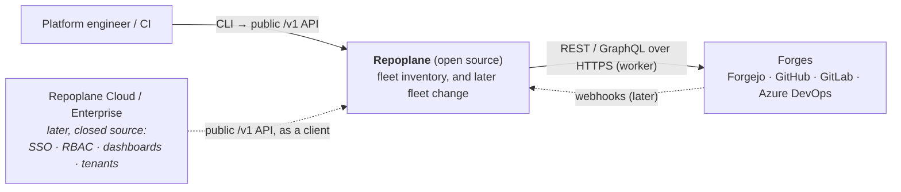
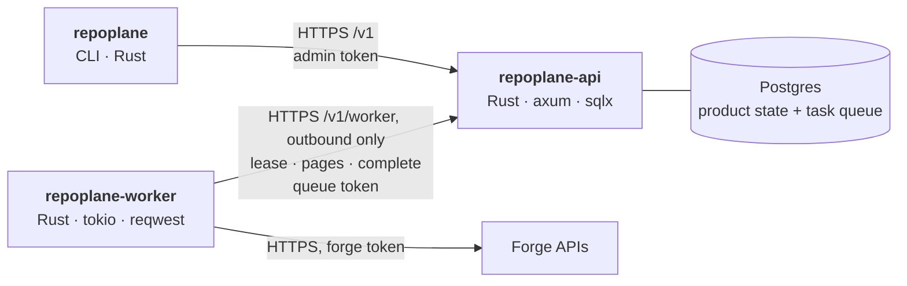

# Architecture

Repoplane keeps an accurate inventory of a repository fleet across **Forgejo, GitHub, GitLab
and Azure DevOps**. Later it will change the fleet and prove the changes converged. This page
has the C4 views (context, containers, components) and the rules that keep them honest. The
decisions behind the rules are in [`adr/`](adr).

Two things shape everything below:

1. **Open source, installable on premises.** The CLI, API and worker are open source and run
   wherever the customer chooses, so a bank can audit every line that touches its code and its
   credentials. A later, separate *Repoplane Cloud / Enterprise* plane consumes the same public
   API and adds SSO, RBAC, dashboards and tenants on top, without a fork. This is the split
   Temporal and Temporal Cloud have.
2. **Four forges from day 0.** They differ too much in pagination, rate limits, topics and
   namespaces to bolt three of them onto a GitHub-shaped core later.

## Level 1: system context



**The rule:** everything that reads source code or holds a forge credential is open source and
runs where the customer chooses. The enterprise plane never talks to a forge. It talks only to
the repoplane API.

## Level 2: containers



| Container | Owns | Talks to | Never |
|---|---|---|---|
| `repoplane` (CLI) | nothing | the API's `/v1` | touches the database or a forge; links neither |
| `repoplane-api` | Postgres: connections, inventory, runs, the task queue; migrations | Postgres; serves `/v1` and `/v1/worker` | calls a forge; holds a forge credential |
| `repoplane-worker` | the forge tokens (read from the variables each connection names) | the API's `/v1/worker` over outbound HTTPS; forges | opens a database; accepts a connection |

**Worker ↔ API are task queues, the way Temporal workers poll Temporal.** A worker long-polls
`POST /v1/worker/lease` for its queue, reports what it finds, and completes or fails the task.
Every connection names a queue (`default` unless told otherwise). One code base therefore gives
three deployments:

```text
Single node          docker compose: api + postgres + worker
Full on-premises     api + postgres + workers, all inside the customer's network
Hybrid (Cloud)       api hosted by Repoplane Cloud; the customer runs only workers on its own queue,
                     so tokens and source code never leave its network, only inventory metadata does
```

The link is HTTPS long-poll rather than gRPC or a broker. One protocol serves the CLI, the
workers and the enterprise plane, and it passes the HTTP proxies and TLS inspection that bank
networks put in the way ([ADR 0008](adr/0008-http-task-queues.md)).

## Level 3: components

### repoplane-api

| Component | Responsibility |
|---|---|
| `http` public (`/v1`) | connections, reconciles (with `?wait=` long-poll), repositories (filtered, keyset-paged). Admin bearer token. |
| `http` worker (`/v1/worker`) | lease, heartbeat, page upload, complete, fail. One bearer token per queue; every call after the lease names the lease id. |
| `store` queue | Postgres task queue: `FOR UPDATE SKIP LOCKED` leases with a TTL, re-lease on expiry, bounded retries. |
| `store` inventory | upsert keyed on `(connection, forge id)`, a per-run watermark, and inaccessible marking after a complete listing only. |
| `store` migrations | embedded; applied by `repoplane-api migrate` only; `serve` refuses a schema other than its own. |

### repoplane-worker

| Component | Responsibility |
|---|---|
| poller | lease loop, bounded concurrency, graceful shutdown (in-flight forge calls are cancelled, and the task goes back on the queue) |
| reconcile | page → HEADs → upload, repeated to the last page, then complete; a background heartbeat keeps the lease through long rate-limit pauses |
| `repoplane-forge` | the four `Lister` adapters and the shared HTTP layer |

### repoplane-forge

```rust
trait Lister {
    fn kind(&self) -> ForgeKind;                                       // and so its Caps
    async fn page(&self, cursor: Option<&str>) -> Result<Page, ForgeError>;
    async fn heads(&self, repos: &[Listed]) -> Result<Vec<Option<String>>, ForgeError>;
}
```

Every method is mandatory, so a forge that cannot do something says so explicitly. One
`HttpClient` under all four adapters owns the retry budget (10 minutes per logical request),
backoff with jitter, and waiting out a rate limit. Each adapter supplies its own **classifier**,
because each forge signals a limit differently. The client also scrubs the token from every
error. The ideas come from forgelab, but the code is written independently: forgelab's own
design requires the harness to be *independently wrong* from the system it tests.

| | Listing | Topics | Archived | Default-branch HEAD |
|---|---|---|---|---|
| **Forgejo** | `GET /orgs/{org}/repos`, 50 per page (the server clamps); only the page *number* is taken from `Link`, because Forgejo writes it from its own `ROOT_URL` | in the payload | `archived` | one `branches/{b}` per repository |
| **GitHub** | `GET /orgs/{org}/repos`, 100 per page, `Link` rel=next only | in the payload | `archived` | GraphQL, 25 aliased lookups per query, 4 queries in flight (100 per query times out) |
| **GitLab** | `GET /groups/{path}/projects?include_subgroups=true`, 100 per page; offset, because keyset is silently ignored on this endpoint | in the payload | `archived`; projects pending deletion excluded | one `repository/branches/{b}` per project, with the branch as a single `%2F`-escaped segment |
| **Azure DevOps** | `GET {org}/_apis/git/repositories`: every project, disabled repositories included, in one answer | **none**: `topics` is `null`, and `--topic` on such a connection is refused | `isDisabled`, whose HEAD cannot be read | one `refs?filter=heads/{b}` per repository, exact name picked |

An empty repository records `head: null` (`—` in the CLI). That is a fact about the
repository, not a failed read.

## Crates and the boundaries between them

```text
crates/
  repoplane-proto    identifiers, API bodies, worker protocol. The ONLY crate every binary links.
  repoplane-forge    the four adapters and the HTTP layer. Linked by the worker only.
  repoplane-store    Postgres store and migrations. Linked by the API only.
  repoplane-api      bin repoplane-api
  repoplane-worker   bin repoplane-worker
  repoplane-cli      bin repoplane
tests/e2e            the end-to-end suite (test-only; links forgelab)
```

`make boundaries` checks these rules against the dependency graph (`cargo tree`) on every lint:
the CLI links neither `sqlx` nor a forge client, the worker links no `sqlx`, and the API links no
forge client and no HTTP client. So "the component with the database cannot reach a forge" is a
property of the build, not just a claim.

## Identifiers

A UUIDv7 written as a type prefix and 26 characters of Crockford base32, such as
`rec_06G9N084KXVH9BQD3DW01R4TA4`. It says what it names, sorts by creation, and cannot be
misread (no `I`, `L`, `O` or `U`). The prefixes are `org_`, `con_`, `rep_`, `rec_` and `tsk_`.

## Secrets

Secrets are named, never written. The API's config names the variables that hold its database
URL, admin token and queue tokens. A connection stores the *name* of the variable that holds its
forge token, and only a worker reads it. The CLI's contexts file names the variable that holds
the API token. No flag takes a secret, and a value that looks like one is refused where a
variable name is expected.

## Testing

The main suite is end-to-end on the **fleets** sandboxes: a local Forgejo, and the
`repoplane-sandbox` organisations on GitHub, GitLab and Azure DevOps. It runs the real API,
worker and CLI binaries. What each sandbox should hold comes from the fleets' `fleet.lock.json`
files, never from test code. Each mutating scenario changes the real forge (a topic, a pushed
commit, an archive, a deletion on local) and asserts that the next reconcile records exactly
that. Then forgelab `reset`s the sandbox and `verify`s it, and a reconcile must bring the
inventory back to the locks. See [`../tests/e2e`](../tests/e2e) and the README.

## Known gaps

- **Offset pagination can skip a repository.** On Forgejo, GitHub and GitLab, a repository
  deleted mid-listing shifts later pages back by one, so one repository can go unseen during an
  otherwise complete listing. That repository is then marked inaccessible until the next
  reconcile sees it again. The candidate fix is to confirm a missing repository with a direct
  lookup before marking it; it needs a `get` per adapter, and is recorded in
  [ADR 0005](adr/0005-conservative-reconciliation.md).
- Listing pages are fetched one after another. For fleets in the thousands, planned page
  fan-out (the Go draft's approach) comes later.
- No rate budget is shared across workers yet: each HTTP client waits out the limits it meets.
